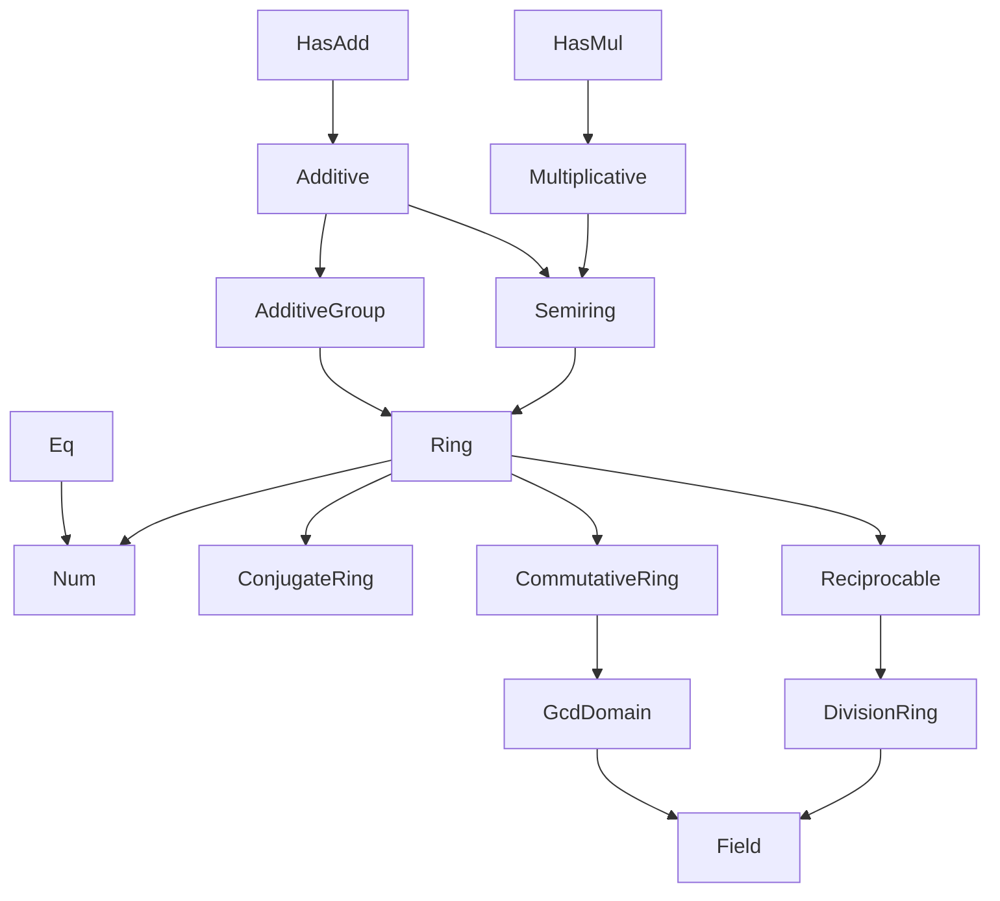
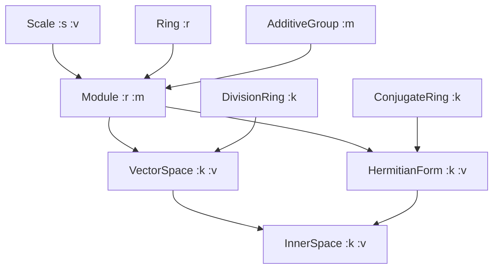

By [Robert Smith](https://twitter.com/stylewarning)

*A few years ago, before Coalton had a language manual, we wrote ["Numbers in a Nutshell"](/post/20220827-numbers/) as a quick reference to arithmetic in Coalton. That practical guide now lives in the manual's new [Numbers and Math](/manual/topics/numbers-and-math/) chapter. In this post, we want to talk about a design mistake we inherited from Haskell—bundling all of arithmetic into a single `Num` class—how it bit us in real programs, and how we fixed it without making everyday code any harder to write.*



## I Just Want to Add Two Vectors

Suppose you're writing a 2D game or a small physics simulation in Coalton. The very first thing you write is a 2D vector:

```lisp
(coalton-toplevel
  (derive Eq)
  (define-struct Vec2
    (x F64)
    (y F64)))
```

Naturally, you want to add two vectors with `(+ u v)`, subtract them with `(- u v)`, negate a vector with `(neg u)`, and add up a list of forces acting on a body with `(list:sum forces)`.

In previous versions of Coalton, `+`, `-`, and `*` all lived in a single type class called `Num`, which we copied almost verbatim from Haskell:

```lisp
;; The old Num interface, using today's spelling of from-int
(define-class (Eq :a => Num :a)
  (+ (:a * :a -> :a))
  (- (:a * :a -> :a))
  (* (:a * :a -> :a))
  (from-int (Integer -> :a)))
```

Look at what happens when you try to make `Vec2` an instance of `Num` just so you can use `+` and `-`:

1. **You have to invent a vector-times-vector multiplication `(* u v)` returning a `Vec2`.**
   What is that supposed to be? The dot product returns a number (`F64`), not a `Vec2`. The cross product doesn't exist in 2D. Componentwise multiplication `(Vec2 (* x1 x2) (* y1 y2))` is a mathematical footgun that silently does the wrong thing if someone passes a `Vec2` to a generic function expecting actual multiplication.
2. **You have to implement `(from-int n)`.**
   What 2D vector is the integer `5`? Is it `(Vec2 5.0d0 5.0d0)`? `(Vec2 5.0d0 0.0d0)`? Or do you define `(from-int _) = (error "Vec2 is not an integer")` and hope nobody ever calls a generic function that uses `0` or `1`?

And notice the trap in that last question: if you made `(from-int _)` signal an error, then `(list:sum forces)` would crash at runtime! Why? Because `list:sum` initialized its accumulator to `(from-int 0)`—there was no standalone `zero` value in the language.

So in practice, you gave up on `+` and wrote `vec2-add`, `vec2-sub`, `vec2-neg`, and `vec2-sum`. In a language whose whole pitch is that type classes let you write generic, ergonomic, zero-overhead code, you were right back to C-style prefixed function names.

## The Workarounds Kept Piling Up

`Vec2` wasn't an isolated annoyance. Everywhere we wrote non-trivial numerical code, `Num` got in the way:

- **Multiplying a vector by a number:** In that same physics simulation, you want to scale a velocity vector `v` by a timestep `dt`. That's an operation of type `F64 * Vec2 -> Vec2`. Because `*` only multiplies two values of the *same* type (`:a * :a -> :a`), every library in Coalton invented its own incompatible scaling function.
- **Raising a matrix to a power:** Repeated squaring needs multiplication and an identity, not a conversion from every integer. Yet `^` used to require `Num`. Matrices expose a second problem: if you read a square matrix from a file, its zeroth power is an identity of the *size you just read*. Knowing the type `Matrix Integer` doesn't tell you that size.
- **Our own FFT library had to reinvent `+` and `*`:** The most damning indictment of `Num` was sitting right inside Coalton's own extended math library. When the author of `coalton/xmath/fft` wrote the Fast Fourier Transform, `Num` was too restrictive for the butterfly operations—so `fft.ct` defined its own arithmetic classes (`FFTGroup`, `FFTRing`, and `FFTField`) that duplicated `+`, `-`, `*`, and `/` under different names!
- **`gcd` demanded `<`:** If you wanted to reduce a fraction of two polynomials like $\frac{x^2 - 1}{x^2 + 2x + 1}$ to $\frac{x - 1}{x + 1}$, or reduce a fraction of complex integers, the algorithm is the exact same Euclidean algorithm used for ordinary integers: divide numerator and denominator by their `gcd`. But Coalton's division and `gcd` classes required `Ord` (`<`), which complex numbers and polynomials don't have.

When your own standard library authors are writing shadow arithmetic classes to route around `Num`, the abstraction isn't pulling its weight.

## Why Didn't We Split `Num` From Day One?

There is a reason Haskell kept `Num` as a single class back in 1990, and why we copied it initially: **splitting `Num` can easily make a language miserable for beginners and everyday programmers.**

When language designers decide to "fix" `Num`, the temptation is to open an abstract algebra textbook and create fifteen classes—`Magma`, `Semigroup`, `Monoid`, `AbelianMonoid`, `Group`, `AbelianGroup`, `Rg`, `Rig`, `Rng`, `Ring`, `CommutativeRing`... Suddenly:

1. A programmer who just wants to write a function that does `(+ a (* b c))` has no idea which class to put in the type signature.
2. A programmer who defines a simple wrapper type (like modular integers or a currency type) has to write seven boilerplate `define-instance` blocks just to get `+`, `-`, `*`, and literals working.

We wanted two things that usually pull in opposite directions:

1. **If you're writing ordinary numeric code, nothing should feel harder than `Num`.**
2. **If you're writing `Vec2`, `Mat4`, polynomials, or an FFT, you should only have to implement the operations that actually make sense.**

## What We Changed

Instead of building a taxonomy of every algebraic structure known to mathematics, we split `Num` into the specific capabilities that real programs actually ask for:



Here is what that means in practice:

- **`HasAdd` (`+`) and `HasMul` (`*`):** If all a function does is add two values, `HasAdd` is enough. It doesn't promise a zero or permission to rearrange the arithmetic. Runtime-sized matrices support both operators: `+` checks that the shapes match, and `*` checks that the inner dimensions match. `==` compares rows, columns, and entries; even a zero-by-two matrix and a zero-by-three matrix are different.
- **`Additive` adds `zero`; `AdditiveGroup` adds `-` and `neg`.** A `Vec2` has a perfectly good zero vector. Giving it an `Additive` instance makes `(list:sum forces)` work even when `forces` is empty, without defining vector multiplication or converting every integer into a vector.
- **`Multiplicative` adds `one`.** That lets `list:product` return an identity for an empty list, and `^` return it for exponent zero. A runtime-sized `Matrix` has neither a bare `one` nor a bare `zero`. Use `(mat:identity-matrix n)` or `(mat:zero-matrix rows cols)` when starting from a shape. When you already have a square matrix `m`, `(mat:mat-pow m 10)` gets the order from `m` itself.
- **`Semiring` and `Ring`:**
  Combine addition and multiplication (`Ring` adds `from-int` for integer literals, without requiring `Eq` for types like computable reals or infinite series where exact equality isn't decidable).
- **`Num` is still `Num`:**
  `Num :a` is simply a `Ring` with `==` (`Eq`). In everyday functions that take numbers, you still write `Num :a => ...`, just like before.
- **`define-num` keeps instance definitions to one block:**
  If your number type already has equality, a single `define-num` form with `+`, `-`, `*`, and `from-int` generates its arithmetic instances. It even fills in `zero`, `one`, and `neg` if you leave them out:

```lisp
(coalton-toplevel
  (derive Eq)
  (repr :transparent)
  (define-type Mod7 (Mod7 Integer))

  (declare make-mod7 (Integer -> Mod7))
  (define (make-mod7 n) (Mod7 (coalton/math:mod n 7)))

  (define-num Mod7
    (define (+ (Mod7 a) (Mod7 b)) (make-mod7 (+ a b)))
    (define (- (Mod7 a) (Mod7 b)) (make-mod7 (- a b)))
    (define (* (Mod7 a) (Mod7 b)) (make-mod7 (* a b)))
    (define (from-int n)           (make-mod7 n))))
```

The same distinction matters for division. `Reciprocable` gives you `/`; it doesn't say that every nonzero element has an exact inverse. `Fraction` is a `Field`, `Quaternion Fraction` is a `DivisionRing` whose multiplication doesn't commute, and `F64` is neither. `QuotRem` lets machine integers divide with remainder without claiming they are exact Euclidean domains.

Approximation has its own contract. When `(approx bits x)` succeeds, the absolute error is at most $2^{-\mathtt{bits}}$ per component; a fixed-precision target can be too coarse. `rational-approx` asks for that bound in `Fraction`. Finding the *simplest* fraction in the interval also requires deciding what happens at its endpoints, so `simplest-fraction` belongs to `Rationalizable`, not `Approximable`.

Back in our physics example, scaling a velocity and taking its dot product don't require pretending that `F64` is an exact field:



Here are the instances for the `Vec2` from the beginning of the post (`math` is a local nickname for `coalton/math`). The dot product is the method of `HermitianForm`; it doesn't require an `InnerSpace` or `VectorSpace` instance:

```lisp
(coalton-toplevel
  (define-instance (HasAdd Vec2)
    (define (+ (Vec2 x1 y1) (Vec2 x2 y2))
      (Vec2 (+ x1 x2) (+ y1 y2))))

  (define-instance (Additive Vec2)
    (define zero (Vec2 0.0d0 0.0d0)))

  (define-instance (AdditiveGroup Vec2)
    (define (- (Vec2 x1 y1) (Vec2 x2 y2))
      (Vec2 (- x1 x2) (- y1 y2)))
    (define (neg (Vec2 x y))
      (Vec2 (neg x) (neg y))))

  (define-instance (math:Scale F64 Vec2)
    (define (math:scale k (Vec2 x y))
      (Vec2 (* k x) (* k y))))

  (define-instance (math:Module F64 Vec2))

  (define-instance (math:HermitianForm F64 Vec2)
    (define (math:inner-product (Vec2 x1 y1) (Vec2 x2 y2))
      (+ (* x1 x2) (* y1 y2)))))
```

## What This Unlocked in `coalton/xmath`

First, we replaced `FFTGroup`, `FFTRing`, `FFTField`, and `FFTCyclicGroup` in `coalton/xmath/fft` with a single `RootsOfUnity` class (`root-of-unity`)—the FFT library now uses standard `+`, `-`, `*`, and `recip` directly—and simplified `Hyperdual :t` into a type alias `(Dual (Dual :t))`, since `Dual`'s polymorphic instances automatically compute second derivatives by the chain rule.

Second, because these algebraic classes compose cleanly, we were able to build a suite of new symbolic, numerical, and geometric modules in `coalton/xmath` that all plug straight into standard operators:

- **Polynomials and rational functions (`polynomial`, `ratio`):** We can form $R[x]$ and nest it to obtain $R[x][y]$. A GCD domain with decidable equality is enough for polynomial resultants and reduced ratios; algorithms that divide by arbitrary nonzero coefficients ask for more. Yun's square-free factorization, for instance, works over a characteristic-zero field.
- **Generic matrices (`mat` below is `coalton/xmath/matrix`):** Bareiss elimination computes determinants and characteristic polynomials over an exact `GcdDomain` with equality, without introducing fractions. `rref`, `solve`, `inv`, and `nullspace` require `Eq` and `DivisionRing` on the *entries*, not a `Ring` instance on the whole matrix. For numerical row reduction, `rref-with` takes an explicit pivot zero test; its pivots aren't an exact rank certificate. Hermitian Gram–Schmidt additionally needs scalar conjugation, and `try-gram-schmidt` reports a nonzero vector with zero self-product rather than dividing by it.

  ```lisp
  (coalton
    (let ((m (mat:from-rows [[(the Integer 1) 1] [1 0]])))
      (mat:to-rows (mat:mat-pow m 10))))
  ;; => ((89 55) (55 34))
  ```
- **Differential Algebra & ODE Operators (`differential`):** `DifferentialRing` (`deriv`) and $n \times n$ Wronskian determinants (`wronskian`), plus non-commutative linear differential operators `DiffOp :a` ($A[\partial; \, '\,]$) where `*` is Leibniz operator composition ($\partial x - x\partial = 1$), `diff-op-gcrd` / `diff-op-lclm` factor and combine ODEs, and `solve-ode-series` solves variable-coefficient linear ODE initial value problems (such as Airy's equation $y'' - xy = 0$) directly into lazy `PowerSeries`.
- **Gröbner Bases (`groebner`):** Sparse multivariate polynomials `MPoly :a` with `Lex`, `GrLex`, and `GRevLex` monomial orders and Buchberger's algorithm (`groebner-basis`, `normal-form`, `ideal-member?`) for solving nonlinear polynomial systems.
- **Modular Algebra, Recurrences & Gosper's Algorithm (`modular`, `recurrence`):** A single `crt` implementation over any `EuclideanDomain` solves both integer Chinese Remainder problems *and* polynomial Lagrange interpolation (`lagrange-interpolate`), while `recurrence` provides Padé approximants (`pade-approximant`), Berlekamp–Massey (`guess-generating-function`), and Gosper's algorithm (`gosper-solve`) for closed-form hypergeometric summation.
- **Quaternions and Clifford algebras (`quaternion`, `clifford-algebra`):** The same `*` can express a Hamilton product or a geometric product without assuming that factors commute. Unit quaternions rotate vectors; Clifford multivectors also have exterior, contraction, and sandwich products.
- **Lazy formal power series (`series` below is `coalton/xmath/power-series`):** A generating function can be an ordinary formula whose coefficients are computed on demand. The Catalan series is $2/(1+\sqrt{1-4x})$: its denominator has constant term $2$, which is invertible over the rationals.

```lisp
(coalton
  (let ((x (the (series:PowerSeries Fraction) series:series-var)))
    (series:series-prefix 7 (/ 2 (+ 1 (sqrt (- 1 (* 4 x))))))))
;; => (1 1 2 5 14 42 132)
```

If you want a practical reference to all of Coalton's number types, arithmetic operations, and classes, head over to the new [Numbers and Math](/manual/topics/numbers-and-math/) chapter in the Coalton manual.